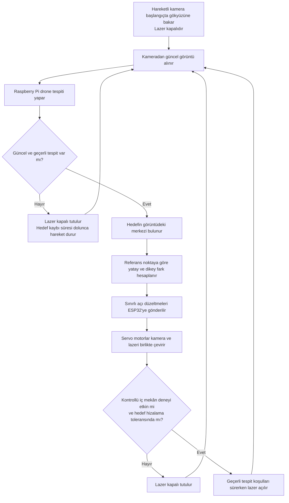

# Kamerayla Drone Tespiti ve Lazer Başlığıyla Yön Takibi

Bu ders projesinde, iki eksenli hareketli bir kameranın görüntülerinden drone tespit edilmesi ve kamerayla aynı başlığa monte edilen lazerin hedefin bulunduğu yöne birlikte çevrilmesi amaçlanmaktadır.

Görüntü işleme ve takip yazılımı Raspberry Pi üzerinde çalışacaktır. Kitin ESP32 kontrol kartı, üreticinin hazır yazılımıyla motor komutlarını uygulayacaktır.

Bu doküman planlanan sistemi açıklar. Tespit mesafesi, gecikme ve yönlendirme doğruluğu prototip üzerinde ölçülecektir.

## Ana Parçalar

| Parça | Görevi |
| --- | --- |
| **Raspberry Pi 5 — 8 GB** | Kamera görüntüsünü işlemek, drone'u tespit edip takip etmek ve motor açılarını hesaplamak. |
| **microSD kart ve aktif soğutucu** | İşletim sistemini ve yazılımı saklamak; Raspberry Pi'yi işlem sırasında soğutmak. |
| **Waveshare 2-Axis Pan-Tilt Camera Module kiti** | Kamera, ESP32 kontrol kartı, iki servo motor ve iki eksenli hareket mekanizmasını sağlamak. Bu parçalar ayrıca satın alınmayacaktır. |
| **Düşük güçlü lazer modülü — Class 2, en fazla 1 mW** | Işının güvenli bir yüzeyde sonlandığı kontrollü deney düzeneğinde yön işaretlemesi yapmak. |
| **DFRobot DFR0457 anahtarlama modülü** | Raspberry Pi'nin kontrol sinyaliyle lazerin beslemesini açıp kapatmak. |
| **Fiziksel lazer durdurma butonu** | Gerektiğinde lazerin enerjisini doğrudan kesmek. Bu buton motorların enerjisini kesen bir sistem durdurucusu değildir. |
| **Güç kaynağı** | İlk kurulumda kitin 12 V adaptörü ve kontrol kartının uygun güç bağlantıları üzerinden sistemi beslemek. Raspberry Pi'ye doğrudan 12 V uygulanmaz. |
| **Sabit taban ve montaj bağlantıları** | Tabanı sabitlemek; kamera ve lazer modülünü aynı hareketli üst başlıkta taşımak. |

Kamera, kitin kendi hareketli üst başlığında kalacaktır. Lazer kameranın yakınına, aynı başlığa monte edilecek; iki parça yatay ve dikey eksenlerde birlikte dönecektir. Raspberry Pi ve kontrol kartı tabanda yer alacaktır. Kablolar için hareket payı bırakılacak ve hareket sınırları doğrulanacaktır. Kitin 360° yatay kapsamı sınırsız ardışık tur olarak kullanılmayacaktır.

## Donanım ve Yazılım Görev Dağılımı

- **Kamera:** Hareketli başlıktan sürekli görüntü alır; motorlar döndükçe görüş yönü değişir.
- **Raspberry Pi:** Drone tespiti ve konum takibini yapar. Hedefin görüntüdeki referans noktasına uzaklığına göre motor açılarını düzeltir ve lazerin açma/kapama koşullarını denetler.
- **ESP32:** Raspberry Pi'den gelen motor komutlarını hazır yazılımıyla uygular.
- **Servo motorlar:** Kamera ve lazerin bağlı olduğu başlığı yatay ve dikey eksenlerde birlikte hareket ettirir.

Raspberry Pi ile ESP32 arasındaki komut iletişimi kitin desteklediği USB veya UART arayüzü üzerinden kurulacaktır. Kullanılacak bağlantı ve komut biçimi, üretici dokümanlarına göre entegrasyon sırasında doğrulanacaktır.

## Genel Akış Diyagramı

## Çalışma Akışının Sözel Açıklaması

Başlangıçta gökyüzüne yöneltilen kameradan sürekli görüntü alınacaktır. Raspberry Pi bu görüntülerde drone'u tespit edip kutusunun merkezini hesaplayacaktır.

Hedefin görüntüdeki referans noktadan uzaklığına göre küçük yatay ve dikey açı düzeltmeleri yapılacaktır. İlk motor denemelerinde referans görüntünün merkezi olacak; kamera–lazer hizalamasından sonra gerekirse değiştirilecektir. Raspberry Pi açı komutlarını ESP32'ye gönderecek; ESP32'nin hazır yazılımı iki servo motorla kamera ve lazeri birlikte çevirecektir.

Her yeni karede hedefin konumu yeniden ölçülecektir. Kamera da hareket ettiği için sabit bir piksel–motor açısı eşleştirmesi kullanılmayacaktır. Referans çevresinde tolerans, hız/açı sınırları ve güncel kare kontrolü uygulanacaktır. Hedef kaybolduğunda veya görüntü kesildiğinde lazer kapatılacak; belirlenen hedef kaybı süresinde motor hareketi durdurulup son konum korunacaktır.

Lazer başlangıçta ve açık hava denemelerinde kapalı kalacaktır. Yalnızca ışının arka yüzeyde sonlandığı kontrollü iç mekân deneyi elle etkinleştirildiğinde, geçerli ve güncel drone tespiti varken ve hedef hizalama toleransındayken açılabilecektir. Tespit kaybı, eski kare, tolerans dışına çıkma, hata veya durdurma lazeri kapatacaktır. Program sonlanması/kilitlenmesi halinde enerjinin kesilmesi ayrıca doğrulanacak; yalnızca yazılımın normal kapanışına güvenilmeyecektir.

## İlk Prototipin Kapsamı

- Gündüz, açık gökyüzü arka planında tek bir drone'un tespiti ve takibi hedeflenmektedir.
- İlk denemeler kısa mesafede başlayacak; başarılı sonuçlara göre yaklaşık 20 metre yüksekliğe ve 10 metre yatay uzaklığa kadar değerlendirilecektir. Bu değerler doğrulanmış performans değildir.
- Tek kamera ile görüntü üzerindeki konum ve görüş yönü elde edilir. Gerçek mesafe veya üç boyutlu konum doğrudan ölçülmez.
- Kamera ile lazer arasındaki konum ve yön farkı kalibre edilecektir. Görüntüdeki takip referansı merkezin dışında olabilir. Tek mesafede yapılan hizalama farklı mesafelerde tam isabet garantisi vermez.
- Kamera yalnızca o anda baktığı alanı görür. İlk prototipte hedef kaybında hareket durdurulup son konum korunur; tüm gökyüzünü aynı anda izleme veya otomatik arama kapsamda değildir.
- Açık hava drone denemelerinde lazer kapalıyken başlığın yön takibi doğrulanacaktır. Lazerle işaretleme, ışının güvenli bir yüzeyde sonlandığı kontrollü bir deney düzeneğinde gösterilecektir.

## Teknik Kaynaklar

- [Waveshare — Pan-tilt kamera kiti dokümantasyonu](https://www.waveshare.com/wiki/2-Axis_Pan-Tilt_Camera_Module)
- [Waveshare — General Driver for Robots kontrol kartı](https://www.waveshare.com/wiki/General_Driver_for_Robots)
- [Raspberry Pi — Resmî dokümantasyon](https://www.raspberrypi.com/documentation/)
