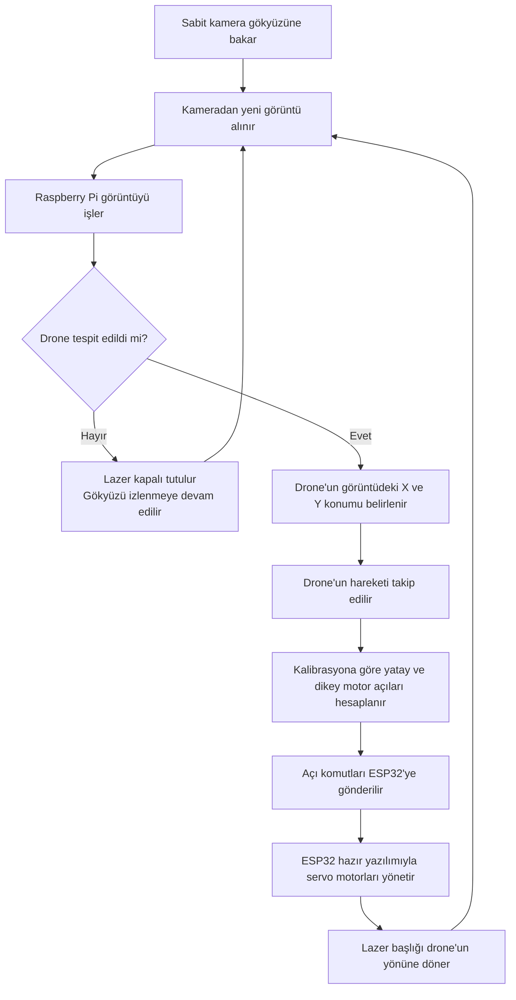

# Kamerayla Drone Tespiti ve Lazer Başlığıyla Yön Takibi

Bu ders projesinde, gökyüzüne bakan sabit bir kameranın görüntülerinden drone tespit edilmesi ve iki eksenli bir mekanizma üzerindeki lazer başlığının drone'un bulunduğu yöne çevrilmesi amaçlanmaktadır.

Görüntü işleme ve takip yazılımı Raspberry Pi üzerinde çalışacaktır. Kitin ESP32 kontrol kartı, üreticinin hazır yazılımıyla motor komutlarını uygulayacaktır.

Bu doküman planlanan sistemi açıklar. Tespit mesafesi, gecikme ve yönlendirme doğruluğu prototip üzerinde ölçülecektir.

## Ana Parçalar

| Parça | Görevi |
| --- | --- |
| **Raspberry Pi 5 — 8 GB** | Kamera görüntüsünü işlemek, drone'u tespit edip takip etmek ve motor açılarını hesaplamak. |
| **microSD kart ve aktif soğutucu** | İşletim sistemini ve yazılımı saklamak; Raspberry Pi'yi işlem sırasında soğutmak. |
| **Waveshare 2-Axis Pan-Tilt Camera Module kiti** | Kamera, ESP32 kontrol kartı, iki servo motor ve iki eksenli hareket mekanizmasını sağlamak. Bu parçalar ayrıca satın alınmayacaktır. |
| **Düşük güçlü lazer modülü — Class 2, en fazla 1 mW** | Işının güvenli bir yüzeyde sonlandığı kontrollü deney düzeneğinde yön işaretlemesi yapmak. |
| **DFRobot DFR0457 anahtarlama modülü** | Raspberry Pi'nin kontrol sinyaliyle lazerin beslemesini açıp kapatmak. |
| **Fiziksel lazer durdurma butonu** | Gerektiğinde lazerin enerjisini doğrudan kesmek. Bu buton motorların enerjisini kesen bir sistem durdurucusu değildir. |
| **Güç kaynağı** | İlk kurulumda kitin 12 V adaptörü ve kontrol kartının uygun güç bağlantıları üzerinden sistemi beslemek. Raspberry Pi'ye doğrudan 12 V uygulanmaz. |
| **Sabit taban ve montaj bağlantıları** | Kamerayı sabit tutmak ve lazer modülünü hareketli başlığa bağlamak. |

Kitin kamera bağlantısı, kameranın sabit tabana alınmasına uygun şekilde düzenlenecektir. Kamera gökyüzünü izlerken yalnızca lazer başlığı hareket edecektir. Kablolar, bağlantı elemanları ve montaj ölçüleri ayrıntılı kurulum listesinde belirlenecektir.

## Donanım ve Yazılım Görev Dağılımı

- **Kamera:** Sabit konumdan sürekli görüntü alır.
- **Raspberry Pi:** Drone tespiti, görüntü üzerinde konum takibi, kalibrasyona göre açı hesabı ve lazerin açma/kapama kontrolünü gerçekleştirir.
- **ESP32:** Raspberry Pi'den gelen motor komutlarını hazır yazılımıyla uygular.
- **Servo motorlar:** Lazer başlığını yatay ve dikey eksenlerde hareket ettirir.

Raspberry Pi ile ESP32 arasındaki komut iletişimi kitin desteklediği USB veya UART arayüzü üzerinden kurulacaktır. Kullanılacak bağlantı ve komut biçimi, üretici dokümanlarına göre entegrasyon sırasında doğrulanacaktır.

## Genel Akış Diyagramı

## Çalışma Akışının Sözel Açıklaması

Gökyüzüne bakan sabit bir kameradan sürekli görüntü alınacaktır. Raspberry Pi bu görüntüleri işleyerek drone'u tespit edecek ve görüntü üzerindeki konumunu takip edecektir.

Tespit edilen konum, önceden yapılan kalibrasyon kullanılarak yatay ve dikey motor açılarına dönüştürülecektir. Raspberry Pi bu açı komutlarını kitin ESP32 kontrol kartına gönderecektir. ESP32, mevcut hazır yazılımıyla iki servo motoru kontrol ederek lazer başlığını drone'un bulunduğu yöne çevirecektir.

Yeni görüntüler geldikçe drone'un konumu ve başlığın yönü güncellenecektir. Drone tespit edilemediğinde veya takip kaybolduğunda lazer kapalı tutulacaktır. Lazer başlığının hedefe yönelmesi, lazerin otomatik olarak açılması anlamına gelmez.

## İlk Prototipin Kapsamı

- Gündüz, açık gökyüzü arka planında tek bir drone'un tespiti ve takibi hedeflenmektedir.
- İlk denemeler kısa mesafede başlayacak; başarılı sonuçlara göre yaklaşık 20 metre yüksekliğe ve 10 metre yatay uzaklığa kadar değerlendirilecektir. Bu değerler doğrulanmış performans değildir.
- Tek kamera ile görüntü üzerindeki konum ve görüş yönü elde edilir. Gerçek mesafe veya üç boyutlu konum doğrudan ölçülmez.
- Kamera ile lazer başlığı arasındaki konum farkı ve mekanik hatalar kalibrasyonda değerlendirilecektir. Yön takibi, lazerin hedef üzerine isabet ettiğini tek başına göstermez.
- Açık hava drone denemelerinde lazer kapalıyken başlığın yön takibi doğrulanacaktır. Lazerle işaretleme, ışının güvenli bir yüzeyde sonlandığı kontrollü bir deney düzeneğinde gösterilecektir.

## Teknik Kaynaklar

- [Waveshare — Pan-tilt kamera kiti dokümantasyonu](https://www.waveshare.com/wiki/2-Axis_Pan-Tilt_Camera_Module)
- [Waveshare — General Driver for Robots kontrol kartı](https://www.waveshare.com/wiki/General_Driver_for_Robots)
- [Raspberry Pi — Resmî dokümantasyon](https://www.raspberrypi.com/documentation/)
